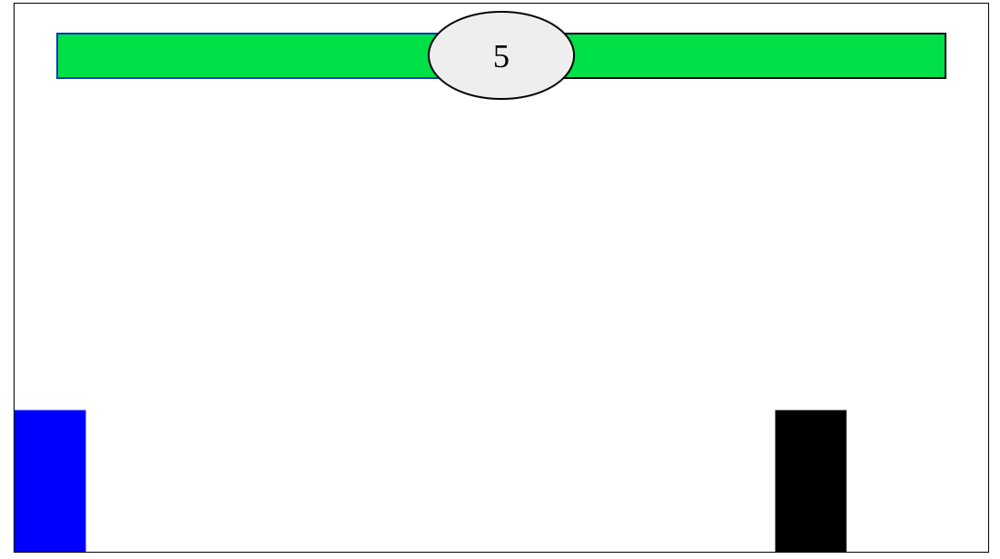

## An Arcade Fighting Game 
This is a basic web fighting game inspired by the likes of MVC, Street Fighter, etc, made in HTML, CSS, and JS (the real heavy hitter). I wanted to break up the monotony of working on a CYOA game for 25 hours straight so starting a new project to divide up my time. I also love this style of fighting games (ESPECIALLY Dragon Ball FighterZ & MVC2) so yet again, another obvious project to start. 

## How to Play
Again, running this game is extremely easy for people of all different computers as it runs in your browser.   
Run the game here: https://cooly-kirbyy.github.io/ArcadeFightingGame/

For now, the controls are extremely simple (and will be expanded upon in the future):

Player One: 
    W: Jump (You can double jump.)   
    A: Move Left   
    D: Move Right   
    S: Crouch    
    F: Punch
    
Player Two:
    Up Arrow Key: Jump (You can also double jump.)   
    Left Arrow Key: Move Left    
    Right Arrow Key: Move Right   
    Down Arrow Key: Crouch    
    Comma: Punch

